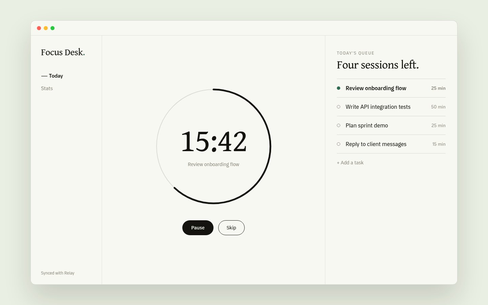
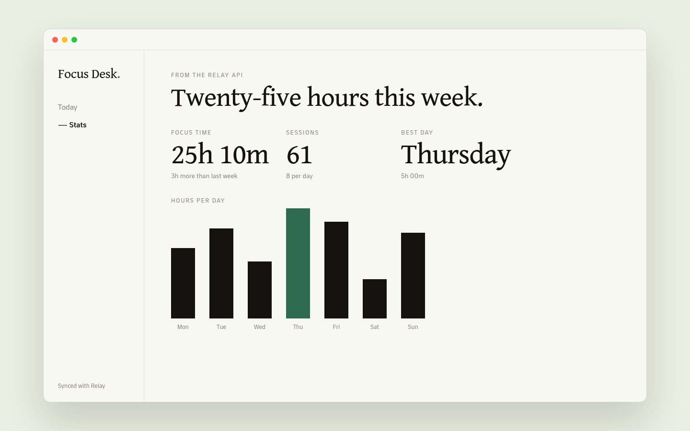

# Focus Desk: Flutter desktop focus timer with backend sync

Personal demo project. A desktop app (Windows, macOS, Linux) built with **Flutter** and **Dart**: a focus timer with a custom-painted progress ring, a task queue saved on the device, and a stats view. Finished sessions sync to the **Relay** Dart backend (separate repo). If Relay is offline, tasks stay local and the sidebar says so.

**Tech:** Flutter desktop, Dart, CustomPainter, Provider (state management), shared_preferences (local storage), window_manager (custom title bar), REST API integration (http), bearer-token auth, Material 3 light editorial theme (paper, ink, forest-green accent, serif headings).

## Run
```bash
flutter config --enable-macos-desktop   # or windows / linux
flutter pub get
flutter run -d macos --dart-define=RELAY_URL=http://localhost:8080 --dart-define=RELAY_USER=admin --dart-define=RELAY_PASS=admin123
flutter test
```

## Honest status
Written without running it on a device. Run `flutter analyze` and `flutter test` first. Screenshots in `docs/` are UI mockups, not recordings.

## Screens (design mockups, not recordings)


